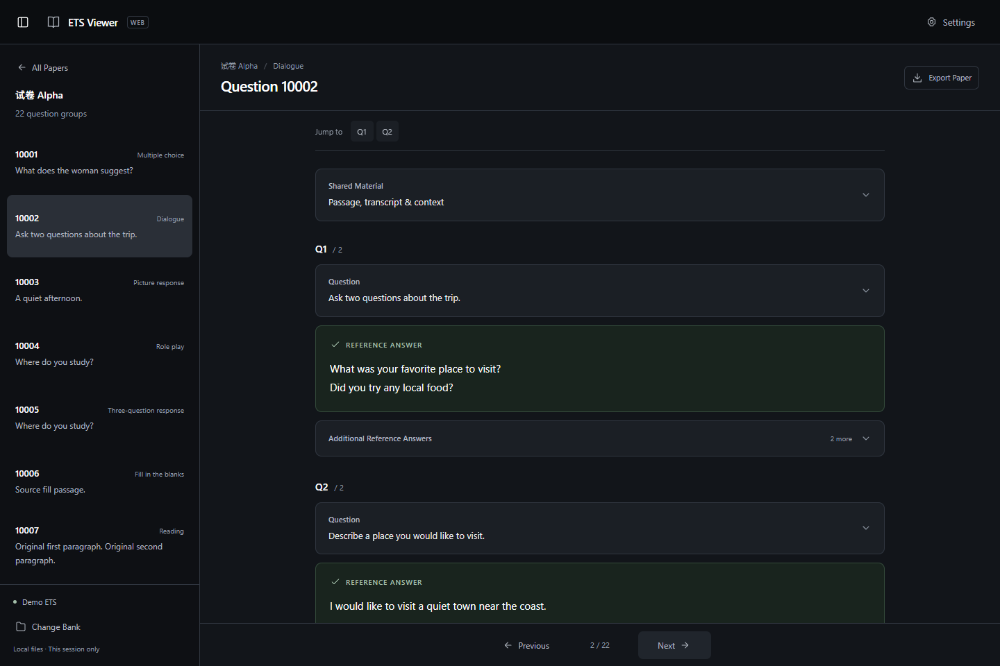
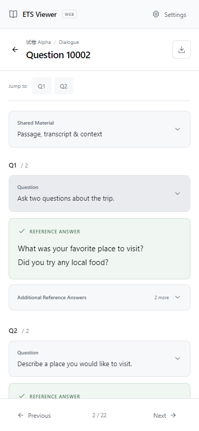

<div align="center">

# ETS Viewer Web

**Your answers, at hand.**

A private, browser-based reader for your ETS question bank.<br>
Open a local folder or ZIP, choose a paper, and read its stored reference answers.

<p>
  <code>React 19</code> &nbsp;·&nbsp;
  <code>TypeScript</code> &nbsp;·&nbsp;
  <code>Vite</code> &nbsp;·&nbsp;
  <code>Local file processing</code>
</p>

[Features](#features) · [Quick start](#quick-start) · [Usage](#usage) · [Privacy](#privacy-and-file-handling) · [Development](#development)

</div>



<details>
<summary><strong>See the mobile reading view · Light mode</strong></summary>

<p align="center">
  
</p>

</details>

<p align="center"><sub>Actual app screenshots using synthetic question-bank content.</sub></p>

## Features

| Capability                     | What you get                                                                                                     |
| :----------------------------- | :--------------------------------------------------------------------------------------------------------------- |
| **Local import**               | Open a question-bank folder or ZIP. Parsing runs in a background worker.                                         |
| **Focused reading**            | See the first reference answer immediately. Expand questions, shared material, and additional answers as needed. |
| **Desktop and mobile layouts** | Browse with a collapsible sidebar on desktop or dedicated paper, question, and reading pages on mobile.          |
| **Original content**           | Read supported question formats, safe rich text, tables, and local images, audio, and video.                     |
| **Appearance controls**        | Follow your system theme or choose Light or Dark in Settings.                                                    |
| **Paper export**               | Download a complete paper as a desktop-compatible UTF-8 text file.                                               |

> Bring your own ETS question bank. This repository contains the viewer and synthetic test
> fixtures; reference answers are displayed from your imported files.

## Quick start

**Requirements:** Node.js **22.12 or later**, npm, and a local copy of this repository.

Run these commands from the project folder:

```sh
npm ci
npm run dev
```

Open the **Local** URL printed by Vite, usually `http://localhost:5173`.
Choose **Select Folder** or **Import ZIP** to load your bank.

### Build and preview

```sh
npm run build
npm run preview
```

The production build is written to `dist/`. Serve that folder with a static HTTP server;
relative asset URLs support hosting under a subdirectory. Node.js is needed for development
and builds only. Use the preview server instead of opening `dist/index.html` with `file://`,
which browsers restrict for modules and workers.

### Open on your phone

1. Connect your computer and phone to the same trusted Wi-Fi network.
2. Start Vite with network access:

   ```sh
   npm run dev -- --host 0.0.0.0
   ```

3. Open the printed **Network** URL on your phone, such as `http://192.168.x.x:5173`.
4. Download the bank to your phone, then use **Select Folder** or **Import ZIP**.

Allow the development server through your computer's firewall on the private network if
needed. VPNs and guest Wi-Fi isolation can prevent access. On your phone, `localhost`
refers to the phone itself.

## Usage

### 1. Import your bank

| Option            | How it works                                                                                                                                          |
| :---------------- | :---------------------------------------------------------------------------------------------------------------------------------------------------- |
| **Select Folder** | Select the bank root, a single paper, or a question directory. Your browser must preserve folder-relative paths.                                      |
| **Import ZIP**    | Select a local ZIP containing the same directory structure. An enclosing top-level folder is optional. Use this when folder selection is unavailable. |

Both controls are available on desktop and mobile. Unicode filenames, spaces, and nested
folders are supported. A typical bank looks like this:

```text
ETS/
└── <paper-id>/
    └── content_<question-group-id>/
        ├── content.json
        ├── content2.json
        ├── info.json
        └── material/
            └── <original images, audio, and video>
```

The scanner validates both `content.json` and `content2.json`. Equivalent copies load
once; complementary fields merge by explicit IDs; conflicting revisions and unrelated
groups remain available with diagnostics. Supported `info.json` choice metadata is a
fallback when neither content file is usable. Other supported JSON is identified by
its content. Invalid records produce warnings while valid records continue loading.
See the [data format guide](docs/data-format.md) for exact reconciliation rules and
supported metadata relationships.

Import warnings appear as a compact count immediately before **Settings**. Open it for
the warning-details dialog: missing media references and their source JSON paths are
shown separately, with attempted resolver paths under **Technical details**. Warnings
remain available while the bank is open, and valid questions continue loading.

Canceling the file picker leaves the page unchanged. **Cancel import** stops the background
worker; **Change Bank** clears the current bank and releases its media resources.

### 2. Read reference answers

- **Choose a paper and question.** Desktop opens the paper's first group; mobile opens its
  question list. Returning to the list restores your scroll position.
- **Expand what you need.** Questions, shared material, and additional answers start collapsed.
  The first stored answer stays visible. Missing answers show **Answer not found**.
- **Move through a paper.** Use **Q1 / Q2** links to jump within a group and **Previous / Next**
  to change groups. Navigation stops at the paper's boundaries.
- **Set your appearance.** Open **Settings** and choose System, Light, or Dark. System is the
  default. Resizing preserves expanded cards; changing groups resets them and the reading scroll.

The modular parser supports `collector.choose`, `collector.role`, `collector.3q5a`,
`collector.fill`, `collector.dialogue`, `collector.picture`, `collector.word`, and
`collector.read`. Choices can contain local images. Keywords stay with their source
question; Key Points and Explanation use the same independent collapsible cards.
Only stored reference answers are shown. Word and reading evaluator or prompt fields
are never treated as answers.

Referenced MP3 and browser-compatible MP4 files use native playback controls in their
own question, shared material, or stored-answer card. Playback never starts automatically.
Collapsing the card, changing groups, leaving mobile reading, or changing banks stops
playback. Other supported local containers are WAV, Ogg audio, M4A, and WebM video;
actual codec support depends on your browser and operating system. Unreferenced files
never appear just because they share a `material/` directory.

### 3. Export a paper

Select **Export Paper** to download the entire selected paper as `.txt`, including every
question part, original options, and the **first stored answer** for each part. Collapsed
cards and the currently visible group do not limit the export.

Exports preserve the desktop text format, original order, UTF-8 BOM, LF newlines, and
Windows-safe filenames. Your browser chooses the save destination; source files are unchanged.
Image options use textual `[Image: reference]` placeholders. Explicit official numbers
take precedence over local numbers when an unambiguous metadata mapping exists.

## Privacy and file handling

Your question bank is processed locally in your browser. The app has no accounts, backend,
uploads, or analytics. Imported content stays in memory for the current session;
**refreshing the page clears the bank**. Only your appearance preference is saved in
`localStorage`. There is no bank restoration, IndexedDB storage, or service worker cache.

Imported HTML is parsed into an allowlisted React tree. Scripts, styles, event handlers,
frames, links, and unsafe resource-loading attributes are removed. Only local image and
audio/video source references enter the media resolver. Images must be local
PNG, JPEG, GIF, BMP, or WebP files beside the source JSON or in its question-local
`material/` directory. Remote URLs, absolute paths, and `file:` references are rejected.

<details>
<summary><strong>Import limits and validation</strong></summary>

| Resource                                                    |                      Limit |
| :---------------------------------------------------------- | -------------------------: |
| Files / ZIP entries                                         |                     20,000 |
| Selected folder, using browser-backed files                 |                      1 GiB |
| Compressed ZIP                                              |                    128 MiB |
| Advertised uncompressed ZIP total, including ignored assets |                    256 MiB |
| Actual extracted total, checked during inflation            |                    256 MiB |
| Individual extracted data file / JSON                       |                     32 MiB |
| Individual audio/video resource                             |                     32 MiB |
| Raster image                                                | 16 MiB / 40 million pixels |
| Individual image width or height                            |              32,768 pixels |

ZIP headers, filenames, sizes, and CRCs are validated. Duplicate, absolute, and traversal
paths, symlinks, encryption, split archives, and ZIP64 are rejected. Filenames must be
UTF-8; recreate legacy archives with Unicode filenames if needed. Supported audio/video
files are retained under the same extraction limits, but only explicit references are
rendered. Unknown template/support assets are not extracted.

Media types are checked against bounded file signatures; image dimensions are checked
before decoding, including EXIF orientation. Missing, mismatched, and undecodable media
show concise type-specific fallbacks. URLs are shared while in use and released after
their last consumer detaches. HTML fragments exceeding 20,000
formatting nodes or 80 nesting levels fall back to their full safe text and image-reference
labels, preserving stored answers and exports.

Large banks may still exceed a mobile browser's available memory. Import a smaller bank
or one paper at a time if necessary.

</details>

## Development

| Command                                                                     | Purpose                                                             |
| :-------------------------------------------------------------------------- | :------------------------------------------------------------------ |
| `npm run dev`                                                               | Start the Vite development server.                                  |
| `npm run build`                                                             | Run the TypeScript check and create the static production build.    |
| `npm run preview`                                                           | Serve the production build locally.                                 |
| `npm test`                                                                  | Run unit and component tests once.                                  |
| `npm run test:watch`                                                        | Run tests in watch mode.                                            |
| `npm run test:browser`                                                      | Check the production build with Playwright and capture screenshots. |
| `npm run test:media`                                                        | Check actual local MP3/MP4 playback, media fallbacks, and cleanup.  |
| `npm run test:parity -- "<desktop-repository-path>" "<question-bank-path>"` | Compare parser output and paper exports with the desktop project.   |

### Browser checks

```sh
npm run build
npx playwright install chromium webkit firefox
npm run test:browser
npm run test:media
```

The script uses installed Edge on Windows and Playwright Chromium on other platforms.
It starts a temporary preview on port **4173** and stops it afterward. Configure it with:

| Environment variable         | Purpose                                              |
| :--------------------------- | :--------------------------------------------------- |
| `ETS_BROWSER_ENGINE=webkit`  | Run with Playwright WebKit.                          |
| `ETS_BROWSER_ENGINE=firefox` | Run with Playwright Firefox, if its runtime works.   |
| `ETS_BROWSER_CHANNEL=chrome` | Use installed Chrome for Chromium checks on Windows. |
| `ETS_BASE_URL`               | Target an already-running local preview.             |

Browser checks use synthetic data. Screenshots go to `docs/screenshots/`; generated test
inputs stay in ignored `.qa/`. The optional parity check needs the desktop project's
Python dependencies. The web app itself runs independently of that project.
The media check uses port **4176**, creates tiny synthetic MP3/MP4 fixtures, and reports
native codec availability separately from app behavior. Fixture generation requires a
Chromium browser with native H.264 MP4 recording support, even when checking another engine.

### Project structure

```text
src/
├── components/       Import, navigation, reading cards, and warnings
├── core/
│   ├── parser/       Typed registry, eight collector modules, and shared utilities
│   ├── scanner/      File discovery, copy reconciliation, metadata, and diagnostics
│   ├── importer/     Folder validation and bounded ZIP extraction
│   ├── exporter/     Paper formatting and browser downloads
│   ├── media/        Typed classification, scoped resolution, diagnostics, URL leases
│   ├── images.ts     Compatibility exports for the previous image API
│   ├── markup.ts     Safe rich-text parsing
│   └── paths.ts      Virtual paths and directory grouping
├── hooks/            Bank lifecycle and appearance preferences
├── styles/           Responsive layout and themes
├── types/            Shared data contracts
├── workers/          Background import and parsing
└── App.tsx           Application layout and navigation state
tests/                Synthetic unit and component tests
tools/                Browser checks and desktop parity tools
docs/                 Data format guide, verification report, and screenshots
```

See [parser architecture and extension guide](docs/parser-architecture.md) for the
normalized contract, registry example, field rules, and guidance on adding collectors.

## Troubleshooting

| Situation                                    | What to do                                                                                                                                                                      |
| :------------------------------------------- | :------------------------------------------------------------------------------------------------------------------------------------------------------------------------------ |
| Folder selection fails or loses paths        | Use **Import ZIP** with the original folder structure intact. Folder picker support depends on your browser and OS.                                                             |
| Files are only available in cloud storage    | Download them through your device's file provider before importing.                                                                                                             |
| **No Exams Found**                           | Check the selected directory and review import warnings. The bank must contain a supported ETS schema.                                                                          |
| Images are missing                           | Keep the original relative assets beside the JSON or in its `material/` directory. Desktop absolute paths cannot be loaded by the browser.                                      |
| Audio/video is unavailable                   | Review import warnings for missing or mismatched files. A present MP4 can still use an unsupported codec; try a browser that supports the original file. No conversion occurs.  |
| An answer is missing                         | **Answer not found** means no answer was found in the supported stored-answer fields. Check the source bank.                                                                    |
| Folder dates show **Date unavailable**       | Browsers expose file modification times, which do not establish a folder's modification date.                                                                                   |
| An import hits a size or memory limit        | Import a smaller bank or a single paper. Expand the import limits above for exact bounds.                                                                                       |
| npm reports `Cannot find module 'lru-cache'` | If this checkout includes the ignored npm helper, replace `npm` with `node .qa/node_modules/npm/bin/npm-cli.js`. See the [environment notes](docs/verification.md) for context. |

The app targets browsers supporting ES2022, module workers, `Blob.arrayBuffer`, and image
decoding. Automated checks cover Chromium and WebKit with desktop and mobile emulation;
physical iPhone, iPad, Android, and macOS browser testing remains unverified. Detailed
coverage and limitations are recorded in the [verification report](docs/verification.md).

## Documentation

| Guide                                                 | Contents                                                                              |
| :---------------------------------------------------- | :------------------------------------------------------------------------------------ |
| [Data format and desktop parity](docs/data-format.md) | Collector schemas, answer precedence, metadata joins, image paths, and export format. |
| [Verification report](docs/verification.md)           | Executed checks, test coverage, environment notes, and known limitations.             |
| [Local media handling](docs/media-handling.md)        | Verified root causes, supported references, resolution, playback, and URL ownership.  |
