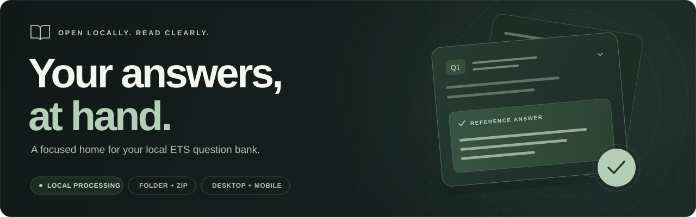

<p align="center">
  
</p>

<div align="center">

# ETS Viewer Web

**A private, focused reader for your local ETS question bank.**

Open a folder or ZIP. Read stored reference answers. Preview and export a whole paper.

<sub>React 19 &nbsp;·&nbsp; TypeScript &nbsp;·&nbsp; Vite &nbsp;·&nbsp; Static hosting</sub>

[Quick start](#quick-start) &nbsp;·&nbsp; [Features](#features) &nbsp;·&nbsp; [Screenshots](#screenshots) &nbsp;·&nbsp; [User guide](docs/usage.md) &nbsp;·&nbsp; [Development](#development)

</div>

## Quick start

You'll need **Node.js 22.12 or later** and **npm**.

```sh
git clone https://github.com/Steven-w65/ETS-Viewer-web.git
cd ETS-Viewer-web
npm ci
npm run dev
```

Open the **Local** URL printed by Vite, usually `http://localhost:5173`, then choose
**Select Folder** or **Import ZIP**.

> [!NOTE]
> Bring your own ETS question bank. The repository includes the viewer and synthetic test
> fixtures. Reference answers come from your imported files.

## Features

<table>
  <tr>
    <td width="50%" valign="top">
      <strong>Open locally</strong>
      <p>Import a folder or ZIP, with Unicode filenames and nested directories preserved. Parsing runs in the background.</p>
    </td>
    <td width="50%" valign="top">
      <strong>Read with focus</strong>
      <p>The first reference answer stays visible. Expand questions, shared material, and additional answers when you need them.</p>
    </td>
  </tr>
  <tr>
    <td valign="top">
      <strong>Review a whole paper</strong>
      <p>Open Preview Answers for a compact text overview of each question's first original reference, grouped in source order.</p>
    </td>
    <td valign="top">
      <strong>Keep the original context</strong>
      <p>Read rich text, tables, and local images. Play referenced audio and video with native controls.</p>
    </td>
  </tr>
  <tr>
    <td valign="top">
      <strong>Read on any screen</strong>
      <p>A desktop sidebar, dedicated mobile pages, and System, Light, or Dark appearance keep navigation familiar.</p>
    </td>
    <td valign="top">
      <strong>Export your answers</strong>
      <p>Download a complete paper as a desktop-compatible UTF-8 text file, with original options and first stored answers.</p>
    </td>
  </tr>
</table>

## Screenshots

<table>
  <tr>
    <th width="76%">Desktop · Dark</th>
    <th width="24%">Mobile · Light</th>
  </tr>
  <tr>
    <td valign="top">
      <a href="docs/screenshots/desktop-reading-chromium.png">
        
      </a>
    </td>
    <td valign="top">
      <a href="docs/screenshots/mobile-reading-chromium.png">
        
      </a>
    </td>
  </tr>
</table>

<sub>Actual app captures using synthetic records. Select an image to view it at full size.</sub>

## Using the viewer

1. **Import your bank.** Select its root folder, a paper, or a question directory. ZIP import
   preserves the same structure and works when your browser cannot select folders.
2. **Choose a paper and read.** Browse its question groups, expand the context you need,
   and use **Previous / Next** to move through the paper.
3. **Preview the answers.** Choose **Preview Answers** for a text overview. A missing, empty,
   or media-only first reference appears as **—**; later alternatives are not substituted.
4. **Export the paper.** **Export Paper** includes every part and its first accepted stored
   answer, even when cards are collapsed or a different group is visible.

Eight formats are supported: **multiple choice, role-play, questions and answers, fill in
the blanks, dialogue, picture description, word / sentence, and reading**. Missing stored
answers remain missing; the viewer does not infer answers from prompts or evaluator fields.

For bank layouts, media formats, import warnings, limits, phone setup, and troubleshooting,
see the **[user guide](docs/usage.md)**. Exact collector schemas are in the
[data format guide](docs/data-format.md).

## Your files stay with you

Question-bank files are processed in your browser. The app has **no accounts, backend,
uploads, or analytics**. Imported markup is filtered, and media resolves only within the
question's local files.

**Refreshing clears your bank.** Only your appearance preference is saved. **Change Bank**
clears the current session and releases its media resources. Source files remain unchanged.
Read about [file validation and resource limits](docs/usage.md#privacy-and-validation).

## Development

The app uses React 19, TypeScript, and Vite, with a module worker for imports and parsing.
The production build contains independent static assets; Node.js is needed to develop
and build the app.

| Command              | Purpose                                                     |
| :------------------- | :---------------------------------------------------------- |
| `npm run dev`        | Start the development server.                               |
| `npm run build`      | Check TypeScript and write the production build to `dist/`. |
| `npm run preview`    | Serve the production build locally.                         |
| `npm test`           | Run unit and component tests.                               |
| `npm run test:watch` | Watch files and rerun tests during development.             |

Serve `dist/` with a static HTTP server. Relative asset URLs support hosting under a
subdirectory. Use HTTP rather than opening `dist/index.html` with `file://`, where browsers
restrict modules and workers.

<details>
<summary><strong>Browser checks, media checks, and desktop parity</strong></summary>

```sh
npm run build
npx playwright install chromium webkit
npm run test:browser
npm run test:media
```

Browser checks use synthetic data. On Windows they default to installed Edge; elsewhere
Chromium uses the Playwright installation. The UI checks run a temporary preview on port
**4173**; media checks use **4176**. Both stop their preview afterward.

| Environment variable         | Purpose                                              |
| :--------------------------- | :--------------------------------------------------- |
| `ETS_BROWSER_ENGINE=webkit`  | Run with Playwright WebKit.                          |
| `ETS_BROWSER_ENGINE=firefox` | Use Firefox if installed and its runtime can launch. |
| `ETS_BROWSER_CHANNEL=chrome` | Use installed Chrome for Chromium checks on Windows. |
| `ETS_BASE_URL`               | Target an already-running local preview.             |

Screenshots are written to `docs/screenshots/`; generated fixtures stay in ignored `.qa/`.
Media fixture generation needs Chromium with native H.264 MP4 recording support, even
when another engine is being checked. Container and codec availability are reported
separately from app behavior. Install Firefox with `npx playwright install firefox` if needed.

To compare against a local desktop repository and bank:

```sh
npm run test:parity -- "<desktop-repository-path>" "<question-bank-path>"
```

This optional check requires the desktop project's Python dependencies. The web app runs
independently of that project. See the [verification report](docs/verification.md) for
executed checks and physical-device limitations.

</details>

## Documentation

| Guide                                              | Find it here                                                                                 |
| :------------------------------------------------- | :------------------------------------------------------------------------------------------- |
| [Using the viewer](docs/usage.md)                  | Import, navigation, preview, export, phone setup, and troubleshooting.                       |
| [Data formats](docs/data-format.md)                | Eight collectors, stored-answer precedence, copy reconciliation, and metadata relationships. |
| [Parser architecture](docs/parser-architecture.md) | Source structure, normalized contracts, the registry, and adding a collector.                |
| [Local media](docs/media-handling.md)              | Supported references, scoped resolution, native playback, and resource ownership.            |
| [Answer preview](docs/answer-preview.md)           | Source order, numbering, text formatting, and first-reference behavior.                      |
| [UI motion](docs/ui-motion.md)                     | Shared transitions, reduced motion, and media lifecycle behavior.                            |
| [Verification](docs/verification.md)               | Test evidence, desktop parity, environment notes, and known limitations.                     |
